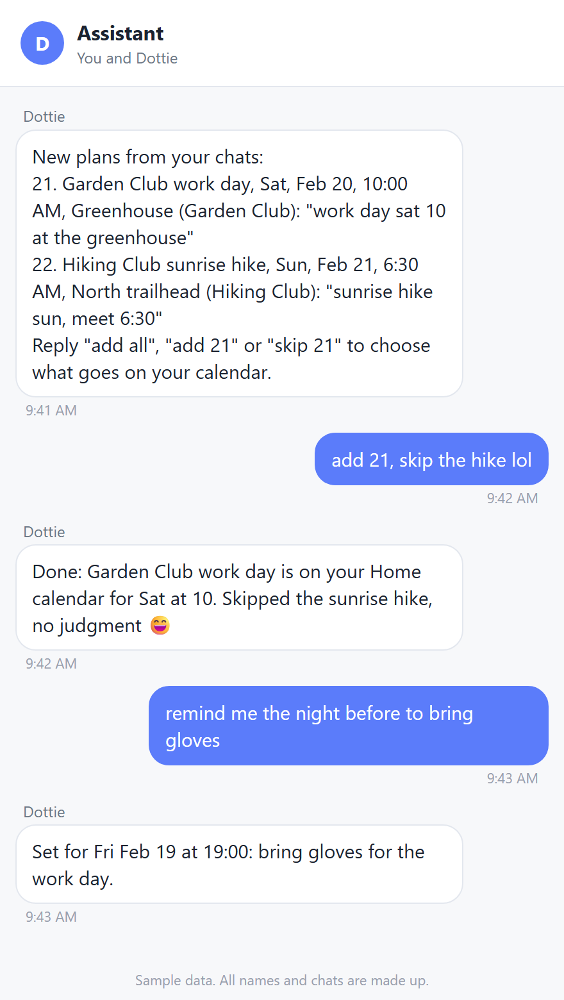
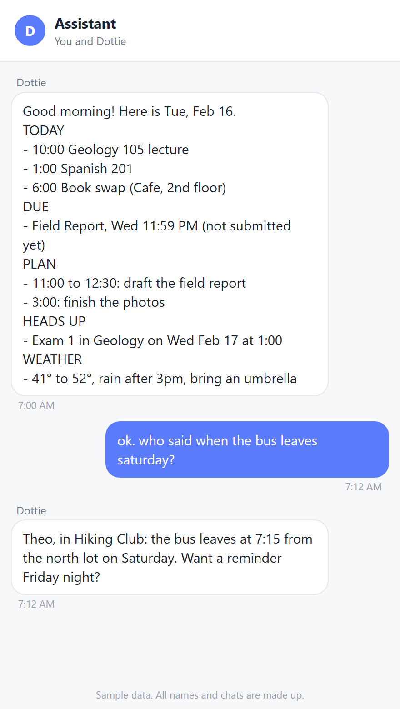
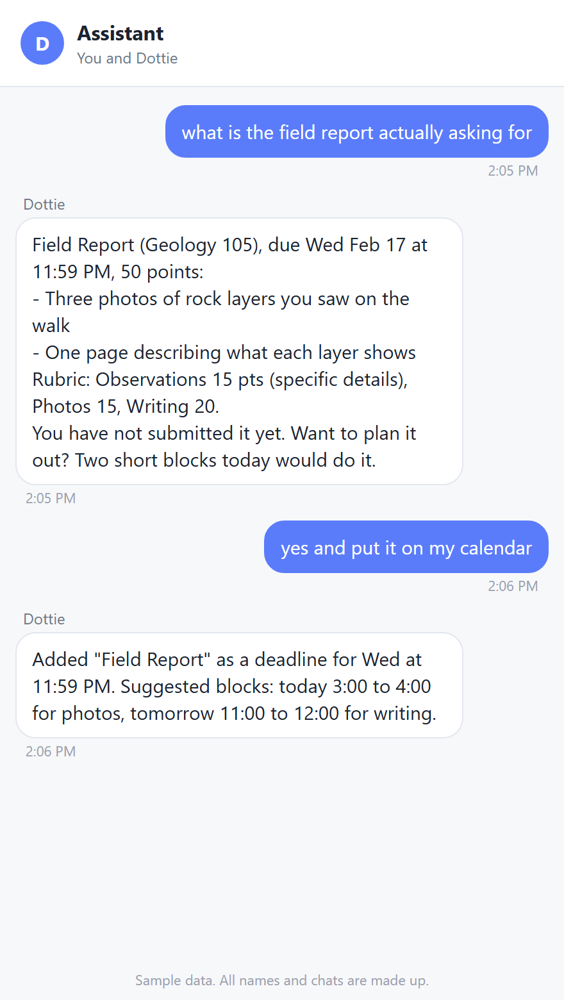

# Dottie: a personal AI assistant in GroupMe

Dottie is an AI assistant I built as a personal project. It lives in a GroupMe chat and runs on your own Cloudflare
account, so no computer has to stay on. It reads your group chats, finds settled plans and asks before putting them
on your Apple Calendar. It also puts your Canvas exams on your calendar, tells you when grades come out, sets
reminders and remembers what you tell it.

> [!WARNING]
> **Personal project. Use at your own risk.** Dottie reads your GroupMe chats, including messages other people
> wrote, and sends the ones that look like plans to an AI model through OpenRouter. It can read and change your
> iCloud calendar. AI models make mistakes, and this code may have bugs. Tell the people in your chats, mute chats
> you don't want read, and read the code before you give it your keys. See [Disclaimer](#disclaimer).



## What Dottie does

- **Finds plans in your group chats.** Every minute it checks your chats for new messages that mention a time or a
  plan. When a chat settles on one, it texts you a numbered list with the day, time, place, chat and the words it
  found. You answer in plain words: "add all", "add 3 and 5", "skip 2". Nothing goes on your calendar without a yes,
  and nothing is brought up twice. Once a day, an hour before your morning brief, it reads every recent chat in full.
- **Reads dates the way people write them.** "Tomorrow" in Monday's message means Tuesday. "8 it is" is read next to
  "does 7 or 8 work?". The model gets a table of dates with their weekdays, and an event whose weekday doesn't match
  its date is asked about instead of guessed.
- **Puts Canvas on your calendar.** Exams and quizzes from your Canvas calendar feed go on by themselves. Any other
  assignment goes on when you ask for it. With a Canvas access token it also reads your classes, instructions,
  rubrics and grades, read only.
- **Watches your grades.** It messages you when an exam or quiz grade is published, and in the evening if online
  work due soon isn't turned in.
- **Sends a morning brief** with your day, what's due, a plan and the weather, and a week rundown on Sundays.
- **Sets reminders**, one-off or repeating ("every Monday at 7 remind me about recycling").
- **Remembers.** It saves facts you mention as notes, keeps every message, learns lasting facts from your chats (who
  organizes a group, when it meets, what things cost), and searches all of it when you ask "do you remember...".
- **Searches your chats.** "Who said the bus leaves at 7?", "catch me up on the choir chat".
- **Reads files and links.** Send a photo, PDF or Word document (a flyer, a syllabus) and say "add this". Paste a
  link and say "summarize this". It can also search the web, with a daily cap.
- **Drafts emails** to professors or anyone else, ready to copy. You send them yourself.

### What it will not do

It writes to one calendar of yours only (the one you name, or else Home, Calendar or Personal). Shared calendars and
your other calendars are read for duplicate checks and briefs, never changed, and repeating events (like weekly
classes) are left to your Calendar app. Canvas access is GET only, so it cannot submit, post or message anyone. It
takes instructions only from you in the Assistant chat: text in a group chat, web page, file or Canvas page is
treated as information, never as orders.

## The Assistant chat

You talk to Dottie in a GroupMe group with only you and its bot in it. It answers there, and that's where plans,
reminders, briefs and grade news arrive.

| Morning brief | Canvas help |
| --- | --- |
|  |  |

Every name, chat, class and date in these screenshots is sample data, not a real account.

## Things to text Dottie

| Text | What it does |
| --- | --- |
| `what's on my calendar this week` | Your week, from all your calendars |
| `add swim practice Tue and Thu at 6am` | Adds them, after checking for duplicates |
| `scan my chats` | Reads every chat from the last six months now and lists new plans |
| `catch me up` | A summary of what you missed in your busiest chats |
| `who said the bus leaves at 7?` | Searches your chats by person and words |
| `what's due this week`, `explain the field report instructions` | Reads Canvas and coaches you through it |
| `remind me at 5 to switch the laundry` | A reminder in the Assistant chat at 5 |
| `remember that I volunteer on Thursdays`, `who am I?` | Saves a note, or writes a profile from what it knows |
| `stop checking <chat name>` | Stops checking that chat for plans |
| `help` | A short guide with examples |
| anything else | A normal conversation, answered with its tools |

## Requirements

- **A Cloudflare account.** The free Workers plan is enough.
- **Node.js 22.13 or newer** on your computer, for the setup commands and the tests. There are no npm packages to
  install.
- **GroupMe**, where you talk to it.
- **An Apple ID with iCloud Calendar**, for an app-specific password.
- **An OpenRouter API key** for the model (Claude Haiku by default, usually a few dollars a month or less depending on
  how busy your chats are). Web searches are about $0.007 each, capped per day.
- **Canvas (optional).** The calendar feed link, and an access token if your school allows them.

## Setup, step by step

### Option A: let a coding agent set it up

Clone the repo, open it in Claude Code, Codex, Cursor or another coding agent, and say:

> Set up Dottie for me by following AGENTS.md. Stop and ask me whenever you need a key, a sign-in or a decision.

[AGENTS.md](AGENTS.md) is written for the agent. It checks your Node version, runs the tests, then walks you through
each account. You still type every key and approve every sign-in yourself. When it finishes, Dottie is running and
has sent you its welcome guide.

### Option B: do it yourself

Setup takes about an hour. Do it on a computer.

1. **Get the code and check it works.**

   ```bash
   git clone https://github.com/sachdevaethan5-prog/dottie-ai-assistant.git && cd dottie-ai-assistant
   ```

   ```bash
   node --version
   ```

   That must print v22.13 or newer.

   ```bash
   npm test
   ```

   All tests run offline against fakes.

2. **OpenRouter.** At https://openrouter.ai/keys, create a key just for Dottie and give it a credit limit (for
   example $10), so a runaway chat can't run up the bill. You enter it in step 9.

3. **Apple Calendar.** Dottie signs in to iCloud with an app-specific password, a separate password you can cancel
   any time.
   1. On your iPhone: Settings, your name, iCloud, and make sure **Calendars** is on. Events kept only "On My
      iPhone" are not in iCloud, so Dottie can't see them.
   2. At https://account.apple.com, sign in, then **Sign-In and Security**, **App-Specific Passwords**, **+**.
      Name it "dottie" and copy the password (xxxx-xxxx-xxxx-xxxx). It is shown only once.
   3. Dottie writes to your calendar named "Home", "Calendar" or "Personal" (or your first own calendar). To use
      another one, set `CALENDAR_NAME` in `wrangler.toml`. The check in step 10 names the one it picked.

   An app-specific password also opens your iCloud Mail and Contacts. Dottie only uses the calendar, but keep the
   password secret, and remove it on the same page to cut Dottie off.

4. **Canvas (optional).**
   - **Feed:** on the Canvas website, open **Calendar**, then **Calendar Feed** at the bottom right, and copy the
     link. If you already subscribed to this feed in Apple Calendar, remove that subscription, or every item shows
     twice.
   - **Token:** on the Canvas website, **Account**, **Settings**, **Approved Integrations**, **+ New Access Token**.
     Copy it; Canvas shows it once. The token can do anything you can do in Canvas, so keep it private. Dottie only
     makes GET requests with it. If there is no **New Access Token** button, your school has turned tokens off and
     everything else still works. Use it for your own account only.

5. **GroupMe.**
   1. At https://dev.groupme.com, sign in and click **Access Token** at the top right. Copy it. It can read all
      your chats, so treat it like a password.
   2. In the GroupMe app, make a new group with only you in it, named "Assistant". That's where Dottie talks to you.

6. **Settings.** Open `wrangler.toml` and fill in `NAME`, `TIMEZONE`, `MORNING_HOUR`, and `LAT`/`LON` for the
   weather. The full list is under [Configuration](#configuration).

7. **Cloudflare.** Sign in, create the database, load the tables and deploy.

   ```bash
   npx wrangler login
   ```

   ```bash
   npx wrangler d1 create dottie
   ```

   Paste the `database_id` it prints into `wrangler.toml`.

   ```bash
   npx wrangler d1 execute dottie --remote --file schema.sql
   ```

   ```bash
   npx wrangler deploy
   ```

   It prints your address, like `https://dottie-ai-assistant.<your-subdomain>.workers.dev`. Then make a private key
   for the GroupMe callback and the test links, and keep it somewhere safe:

   ```bash
   node -e "console.log(crypto.randomUUID().replaceAll('-',''))"
   ```

8. **The GroupMe bot.** At https://dev.groupme.com, open **Bots**, **Create Bot**:
   - Group: "Assistant"
   - Name: "Dottie" (or anything you like)
   - Callback URL: `https://dottie-ai-assistant.<your-subdomain>.workers.dev/groupme/<your key from step 7>`

   Copy the **Bot ID**.

9. **Secrets.** Run each line and paste the value when it asks. Secrets never go in `wrangler.toml`.

   ```bash
   npx wrangler secret put OPENROUTER_API_KEY
   ```

   ```bash
   npx wrangler secret put GROUPME_TOKEN
   ```

   ```bash
   npx wrangler secret put GROUPME_BOT_ID
   ```

   ```bash
   npx wrangler secret put CALLBACK_KEY
   ```

   ```bash
   npx wrangler secret put ICLOUD_EMAIL
   ```

   ```bash
   npx wrangler secret put ICLOUD_APP_PASSWORD
   ```

   ```bash
   npx wrangler secret put CANVAS_FEED_URL
   ```

   ```bash
   npx wrangler secret put CANVAS_TOKEN
   ```

10. **Check everything is found.** Replace KEY and the address. This reads GroupMe and your calendar without
    sending or changing anything: it names the bot's group, lists your chats and calendars, and counts this week's
    events.

    ```bash
    curl -H "Authorization: Bearer KEY" "https://dottie-ai-assistant.<your-subdomain>.workers.dev/run?job=check"
    ```

11. **Say hi.** The command below sends the welcome guide to your Assistant chat. Then text Dottie about yourself
    (what you study, your schedule, the people you mention), and it saves what matters as notes.

    ```bash
    curl -H "Authorization: Bearer KEY" "https://dottie-ai-assistant.<your-subdomain>.workers.dev/run?job=welcome"
    ```

To stop Dottie reading a chat, text `stop checking <chat name>`. To turn it off completely, delete the bot at
https://dev.groupme.com, or remove the Worker in the Cloudflare dashboard. Live logs, if something is off:
`npx wrangler tail`.

## Configuration

Settings live under `[vars]` in [wrangler.toml](wrangler.toml). Change one, then run `npx wrangler deploy`. The main
ones:

| Variable | Default | What |
| --- | --- | --- |
| `NAME` | empty | Your first name, the way Dottie should call you |
| `ASSISTANT_NAME` | `Dottie` | What the assistant calls itself |
| `TIMEZONE` | `America/New_York` | Your time zone (IANA name) |
| `MORNING_HOUR` | `7` | Hour of the morning brief |
| `SCAN_HOUR` | empty | Hour of the daily full scan of your chats; empty means an hour before the brief |
| `NUDGE_HOUR` | `20` | Hour of the evening nudge about Canvas work not turned in |
| `LAT`, `LON` | empty | Where your weather is for; empty turns weather off |
| `SCHOOL` | empty | Your school, for "who am I" |
| `CALENDAR_NAME` | empty | The iCloud calendar it writes to; empty picks Home, Calendar or Personal |
| `SEARCH_CHATS` | empty | Chats searched by default, as a pattern like `Hiking\|Orchestra`; empty searches your 6 most recently active chats |
| `WEB_SEARCHES_PER_DAY` | `30` | Cap on web searches |
| `MODEL` | `anthropic/claude-haiku-5.5` | OpenRouter model for chatting |
| `EXTRACT_MODEL` | `anthropic/claude-haiku-5.5` | OpenRouter model for reading chats |

Secrets are set with `npx wrangler secret put`: `OPENROUTER_API_KEY`, `GROUPME_TOKEN`, `GROUPME_BOT_ID`,
`CALLBACK_KEY`, `ICLOUD_EMAIL`, `ICLOUD_APP_PASSWORD`, `CANVAS_FEED_URL` and `CANVAS_TOKEN`. For `npx wrangler dev`,
copy [.dev.vars.example](.dev.vars.example) to `.dev.vars`, which git ignores. Nothing answers until `CALLBACK_KEY`
is set.

Manual runs and test runs need the header `Authorization: Bearer <CALLBACK_KEY>`:

- `GET /run?job=<job>` runs one job now: `check` (read-only setup check), `welcome`, `canvas`, `grades`, `groupme`,
  `daily`, `morning`, `nudge`, `reminders`, `learn` (reads every chat into memory, 8 a run, repeat until "0 left"),
  `relearn`, `tidy`, and `selftest` (adds, moves and deletes a test event at 3am a month out).
- `POST /test/ask` with `{"text": "what's due this week?"}` runs a real conversation without sending anything or
  changing your calendar or the database. The answer comes back with every tool call. Add `"turns"` to replace the
  saved history, and `"files"` or `"images"` to test attachments.
- `POST /test/extract` with `{"chats": [{"group", "about", "msgs": [{"name", "text", "sent"}]}]}` shows what it
  would pick out of some chat messages.

The prompts live in `src/agent.js` (chat) and `src/groupme.js` (reading chats). The cron schedule lives in
`wrangler.toml` and `src/index.js`.

## How it is built

```
src/
  index.js      the Worker: GroupMe callback, crons, /run and /test endpoints, job failure alerts
  agent.js      the system prompt, the tools, and the chat loop over OpenRouter
  groupme.js    reading chats, picking out plans, full scans, learning facts, search, catch-up
  calendar.js   iCloud CalDAV and iCalendar text: list, add, move, delete, duplicate-safe ids
  canvas.js     the Canvas feed sync, the read-only Canvas API, grades and evening nudges
  memory.js     notes with topics and history, chat facts, clean-up of repeats and expired facts
  reminders.js  one-off and repeating reminders
  web.js        web search (OpenRouter's web plugin), reading links, weather (Open-Meteo)
  files.js      photos, PDFs, Word documents and text files sent to the chat
schema.sql      the D1 tables
test/           offline tests with fake GroupMe, Canvas, iCloud and OpenRouter, on node:sqlite
```

It is plain JavaScript on Cloudflare Workers with no dependencies. Storage is Cloudflare D1. Three cron triggers
split the work, because the free plan allows 50 outside requests per run: every minute (reminders and chats), every
10 minutes (Canvas, grades, memory) and every hour (the daily scan, the morning brief and the nudge). One deployment
serves one person. Up to 8 changed chats are read a minute, the newest 25 messages of each, and only chats with
messages in the last six months.

## Disclaimer

This is a personal project, shared for learning. Use it at your own discretion and risk.

- **Your chats go to an AI model.** Messages from your group chats, including messages other people wrote, are sent
  to OpenRouter and the model provider you choose, along with your notes, calendar and Canvas details when they are
  needed for an answer. Read their terms. Tell the people in your chats, and mute any chat you don't want read.
- **AI can be wrong.** Language models make confident mistakes. Check important dates yourself. Dottie asks before
  adding plans from chats, but it can still misread a date or miss an event.
- **No warranty.** The software is provided "as is", without warranty of any kind (see [LICENSE](LICENSE)). The
  authors are not responsible for missed events, wrong calendar entries, or any loss or damage from using it.
- **School rules.** Dottie coaches you on assignments and does not write work for you to hand in. Follow your
  school's academic integrity rules. Your Canvas token is for your own account only.
- **You are responsible** for your keys, for following the terms of GroupMe, Apple, Instructure, OpenRouter and
  Cloudflare, and for what you ask it to do.
- **Not affiliated.** This project is not affiliated with, endorsed by or sponsored by GroupMe, Microsoft, Apple,
  Instructure (Canvas), OpenRouter, Anthropic, Cloudflare or Open-Meteo. Their names are used only to describe what
  the software works with. All trademarks belong to their owners.
- **Bring your own credentials.** There is no hosted version. Never share your keys.

## Credits

- **[beeper/groupme](https://github.com/beeper/groupme)**, whose GroupMe bridge showed how GroupMe's file service
  hands over files sent in a chat.

## License

[MIT](LICENSE). Security reports: see [SECURITY.md](SECURITY.md).
